<p align="center">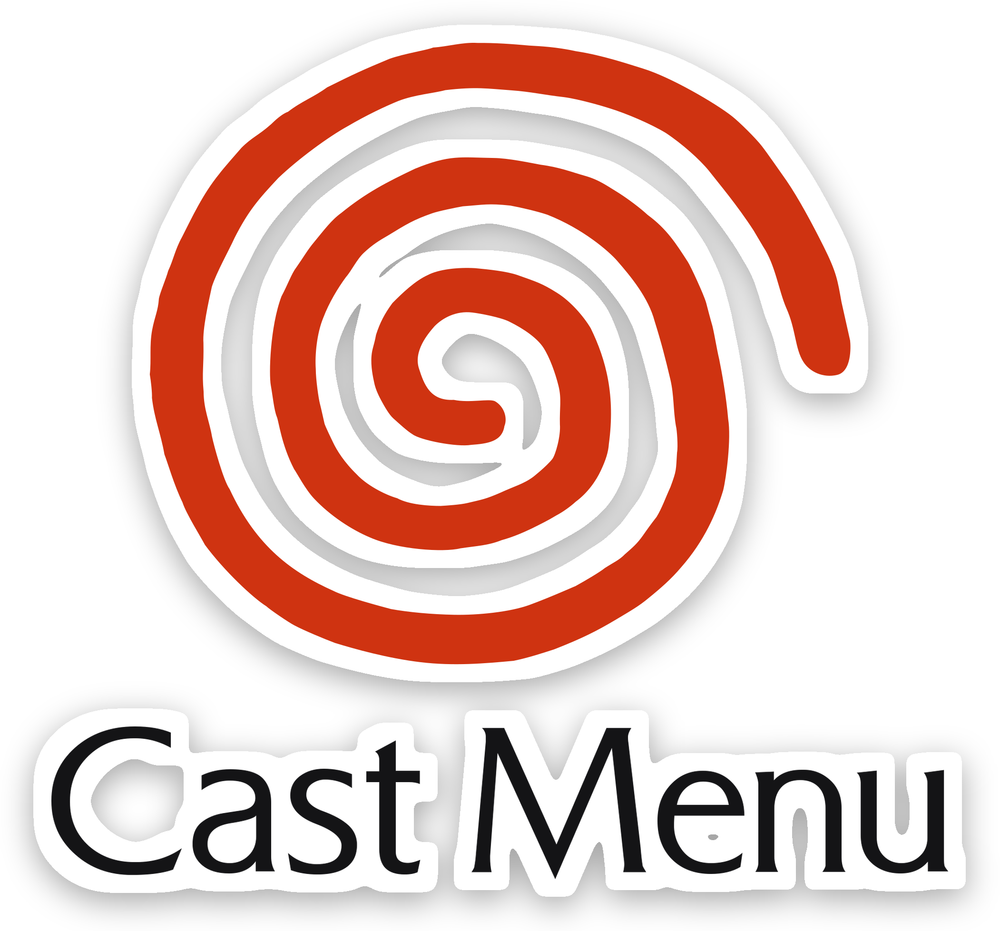</p>

<p align="center"><b>An open, good-looking game menu for GDEMU on the Sega Dreamcast.</b></p>

<p align="center">
<a href="https://github.com/hudsonbrendon/castmenu/actions/workflows/build.yml"></a>
<a href="https://github.com/hudsonbrendon/castmenu/releases"></a>
<a href="LICENSE"></a>
<a href="https://buymeacoffee.com/hudsonbrendon"></a>
</p>

Cast Menu replaces GDMENU on the SD card of a GDEMU-modded Dreamcast: coverflow with covers, gameplay
clips and music, synopses, play time, cheats, VMU saves and a Dreamcast-style launch animation. Open
source end to end: menu (KallistiOS), loader, card tool and the optional chat server.

## Features

- **Library**: coverflow, list and grid; a cover for every game; categories, your own collections and search.
- **Per game**: background gameplay clip, theme music, screenshots, synopsis in 6 languages, play time, cheats.
- **Launch animation**: the console opens, the game's cover lands as a disc and spins while the real progress bar fills.
- **Open loader**: Region Free, Force VGA, In-Game Reset, boot animation and license screen switches, Game ID for VM2 / VMUPro.
- **VMU saves**: list, copy between cards, delete, cloud backup through the Cast server.
- **Online** (BBA or DreamPi): Cast Chat with voice messages, Cast AI, clock sync, Dreamcast Now counter.
- **Themes**, menu music and UI sounds, profile with avatar, controller / mouse / keyboard, System screen with statistics.
- Works with cards made by GDMENU Card Manager; the included card tool fetches covers, synopses, clips and music.

Full feature list and details: [docs/MENU.md](docs/MENU.md).

## Screenshots

| | |
|---|---|
| 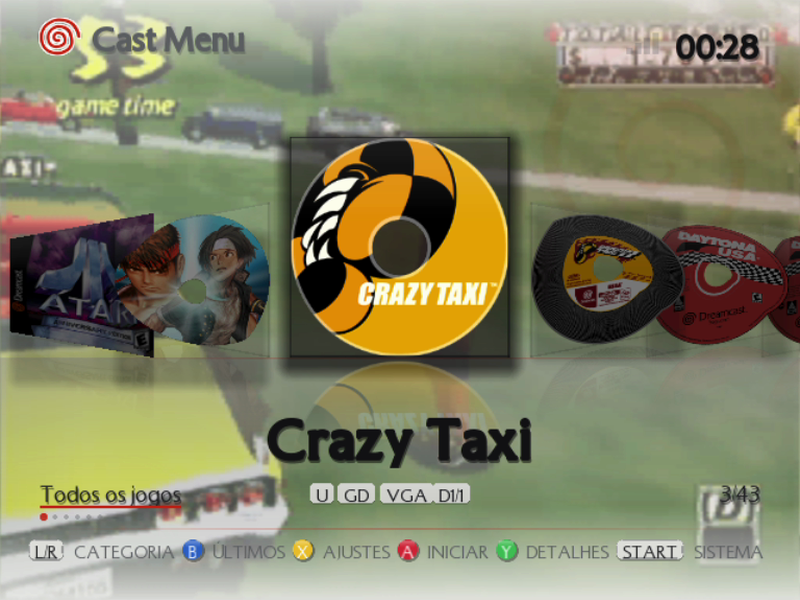 | 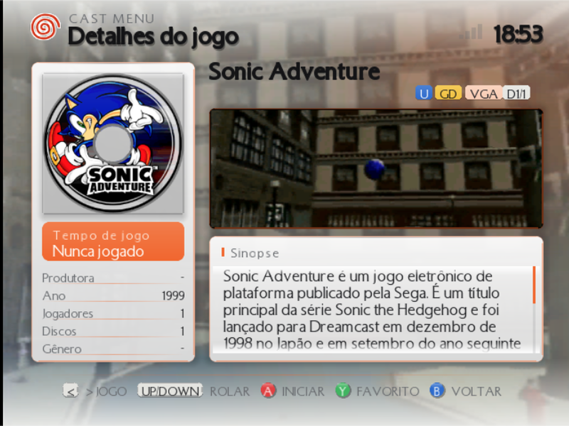 |
| 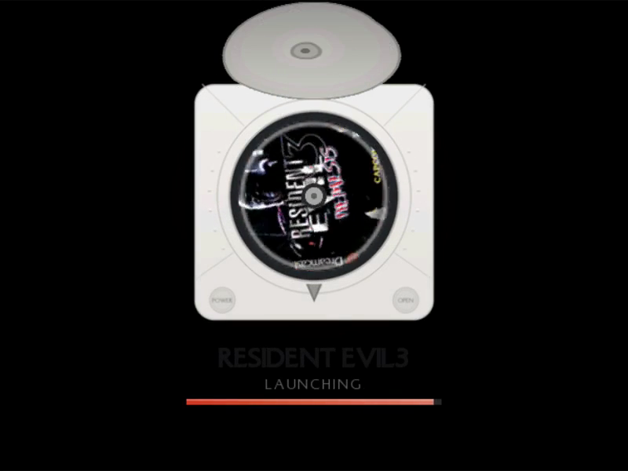 | 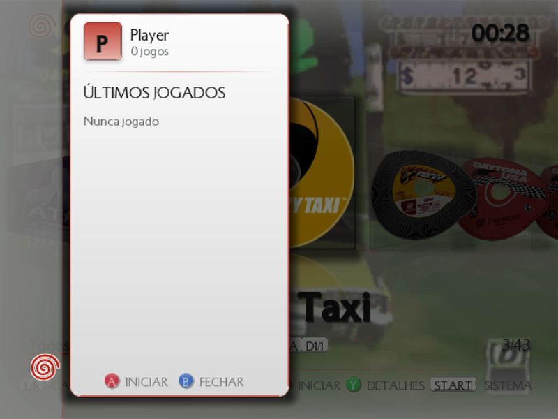 |
| 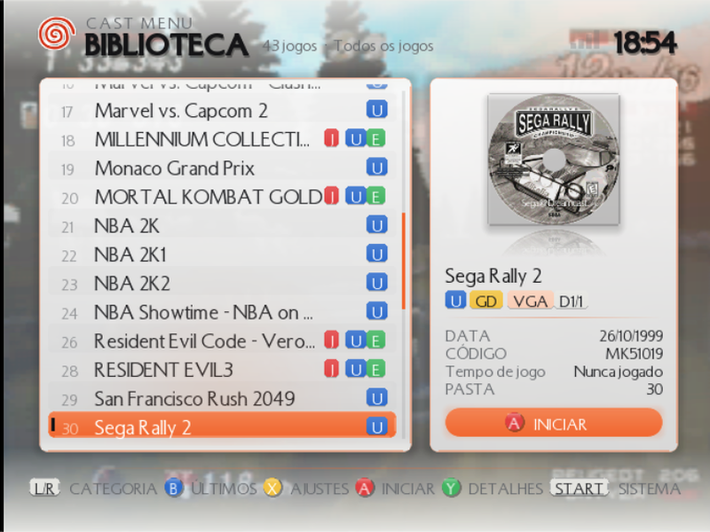 | 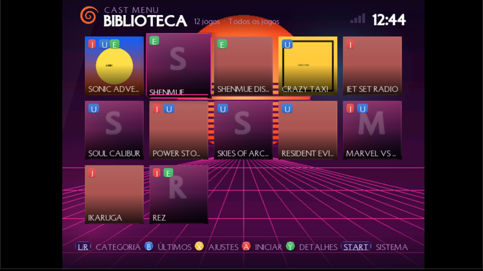 |
| 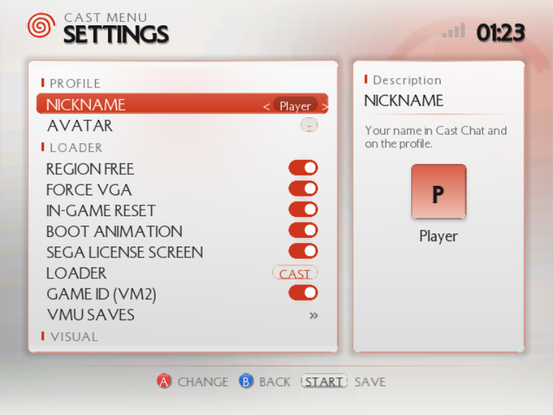 | 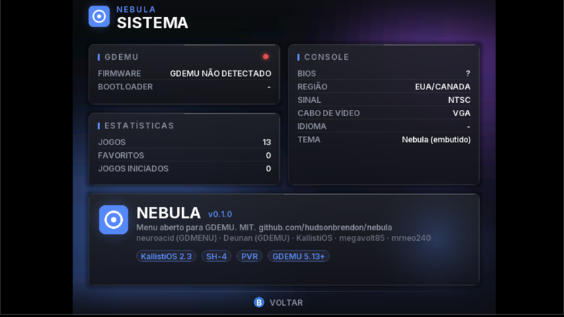 |
| 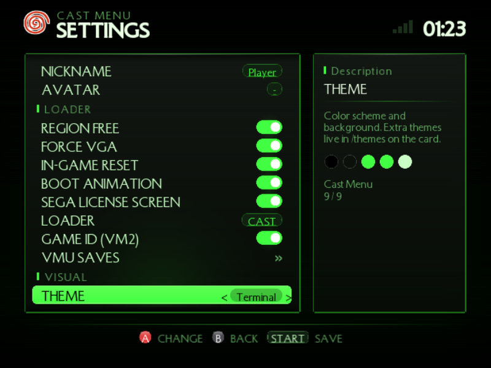 | 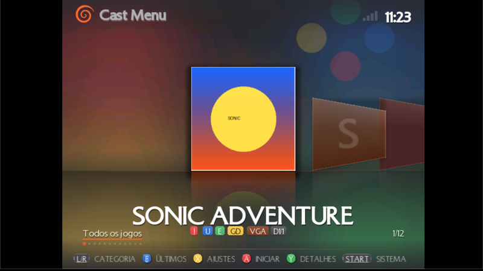 |

Captured in the redream emulator from a real card. More in `docs/screenshots/`.

## Quick start

1. Download `castmenu-<version>.zip` from [Releases](https://github.com/hudsonbrendon/castmenu/releases)
   and unzip it. It contains the menu binary (`1ST_READ.BIN`), the card tool (`tools/cast_card`),
   the themes and the docs. No compiler needed.
2. Install the PC requirements (see below): Python 3, Pillow, numpy, `mkisofs`; `ffmpeg` and
   `yt-dlp` only if you want clips.
3. Put your games on the SD card, one image per folder (`02`, `03`, ...). See *Preparing the SD card*.
4. From the unzipped folder, run:

   ```bash
   python3 -m tools.cast_card fetch /Volumes/GDEMU --videos --music   # covers + screenshots + synopses + clips + music (optional)
   python3 -m tools.cast_card build /Volumes/GDEMU            # writes the menu into 01/
   ```

   On Windows use the drive letter instead of `/Volumes/GDEMU` (for example `E:\`).
5. Eject the card, put it in the GDEMU, turn the Dreamcast on.

## Install with an AI agent

Let an agent do the whole setup. Paste this into Claude Code, Codex, Cursor or any agent that can run
shell commands on the machine where the SD card is mounted:

```
Read https://raw.githubusercontent.com/hudsonbrendon/castmenu/main/docs/AI_INSTALL.md and follow it
to set up Cast Menu on my GDEMU SD card mounted at /Volumes/GDEMU. My game images are in ~/Dreamcast.
Fetch covers, synopses, clips and music, build the card, verify it and tell me when I can eject it.
```

The runbook in [docs/AI_INSTALL.md](docs/AI_INSTALL.md) tells the agent what to install, how to lay
out the card, what every command does and how to check the result.

## Documentation

- [Preparing the SD card](docs/CARD.md): requirements, folder layout, adding games, covers / synopses / clips / music, collections, cheats, build options, troubleshooting.
- [Using the menu](docs/MENU.md): controls, settings, themes, VMU saves, Cast Chat and Cast AI.
- [Building from source](docs/BUILD.md), [themes](docs/THEMES.md), [chat protocol](docs/PROTOCOL.md), [reverse engineering notes](docs/REVERSE_ENGINEERING.md), [changelog](CHANGELOG.md).

## Roadmap

Open an issue to vote or to suggest more.

- Full cheat engine (conditional, pointer and slide codes) and an importer for the CodeBreaker database.
- Box-back art in the details screen.
- Dreamcast Now presence from the console (today only DreamPi reports it; the menu shows the online count).
- Theme editor on the console.

## Support the project

Cast Menu is free and open source. If it saved you an afternoon with your Dreamcast, you can
[buy me a coffee](https://buymeacoffee.com/hudsonbrendon) ☕ or star the repo. Bug reports and pull
requests are just as welcome.

<p align="center"><a href="https://buymeacoffee.com/hudsonbrendon"></a></p>

## Credits and license

MIT. Thanks to neuroacid (GDMENU), Deunan (GDEMU), KallistiOS, megavolt85 (gdemu_sdk), mrneo240
(openMenu), sonik-br (GDMENU Card Manager), the libretro thumbnail project and Wikipedia.
Dreamcast and the swirl are trademarks of SEGA; this is a fan project with no affiliation. The
Dreamcast logo artwork comes from Wikimedia Commons (public domain as a simple logo); the menu font
is the NiseSegaDreamcast fan font.
