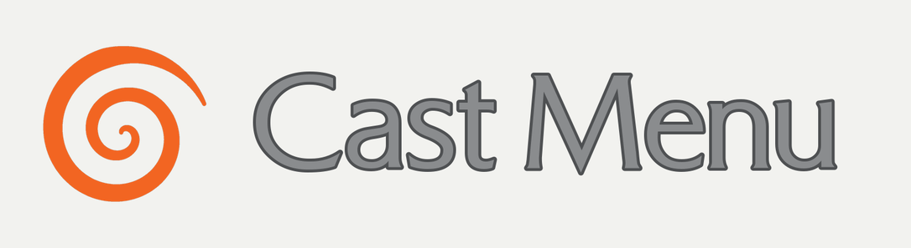
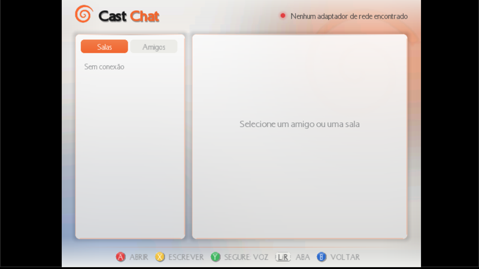

<p align="center"></p>

# Cast Menu — menu aberto para GDEMU (Sega Dreamcast)

[](https://github.com/hudsonbrendon/castmenu/actions/workflows/build.yml)
[](https://github.com/hudsonbrendon/castmenu/releases)

Alternativa aberta ao GDMENU e ao Dream Menu, feita a partir da engenharia reversa do GDMENU 0.6
com REA + Ghidra (`docs/REVERSE_ENGINEERING.md`). Interface renderizada no PVR com **coverflow**
elegante e fluido, lista e grade, **categorias inteligentes** (gênero e plataforma: Atomiswave,
CPS1/CPS2, Neo Geo CD, Ports e Homebrew), **detalhes com sinopse**, **perfil com avatar**,
**sidebar de últimos jogados com tempo de jogo**, **Cast Chat** (salas, amigos, mensagens privadas
e **de voz** pelo microfone do Dreamcast), **Cast AI** (perguntas por texto ou voz), **6 idiomas**
(pt, en, es, de, fr, it), visual com as cores do controle do Dreamcast (temas Dreamcast, Dreamcast Dark,
Controller e mais), tipografia do logotipo Dreamcast, relógio e sinal de rede, e um
**bootloader aberto** com Region Free, Force VGA, In-Game Reset, pular animação de boot e tela SEGA.

Compatível com cartões já montados pelo GDMENU Card Manager (`LIST.INI`) e com a ferramenta
própria `cast_card`, que extrai capas das imagens, gera sinopses/categorias e a pasta `01/`.

Binários prontos em [Releases](https://github.com/hudsonbrendon/castmenu/releases) (gerados pelo CI a cada tag `v*`).

```
./build.sh                                   # compila (Docker + KallistiOS)
python3 -m tools.cast_card build /Volumes/GDEMU
python3 server/cast_server.py --ai anthropic  # servidor do Cast Chat / Cast AI (opcional)
```

Controles (coverflow): ◀ ▶ navega · **A** iniciar · **Y** detalhes · **B** últimos jogados ·
**X** ajustes · **START** sistema · **L / R** categoria anterior / próxima · L+R juntos pula para uma letra.
No Cast Chat: **X** escrever · **Y** segurar para gravar voz · **L/R** salas / amigos.

| | |
|---|---|
|  |  |
|  |  |
|  |  |
|  |  |
|  |  |

Mais em `docs/screenshots/` (capturas do redream).

Pastas: `src/` menu (KOS), `src/net/` rede + protocolo do chat, `ldr/` loader, `server/` servidor
de referência (Python, stdlib), `tools/cast_card/` ferramenta de cartão, `themes/` temas editáveis,
`assets/lang/strings.tsv` traduções, `docs/` protocolo, chat, temas, build e engenharia reversa.

Rede: adaptador BBA/LAN (DHCP) ou modem via DreamPi ("Wi-Fi"), ver `docs/CHAT.md`.
Requer GDEMU com firmware 5.13.0+. Testado no emulador redream (UI completa, protocolo no host);
loader, comandos GDEMU, rede e microfone só podem ser validados no console real — ver
`docs/REVERSE_ENGINEERING.md` §7. MIT. Agradecimentos: neuroacid (GDMENU), Deunan (GDEMU),
KallistiOS, megavolt85 (gdemu_sdk), mrneo240 (openMenu), sonik-br (Card Manager).
